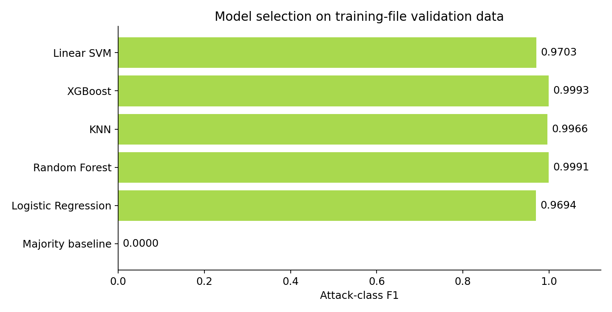
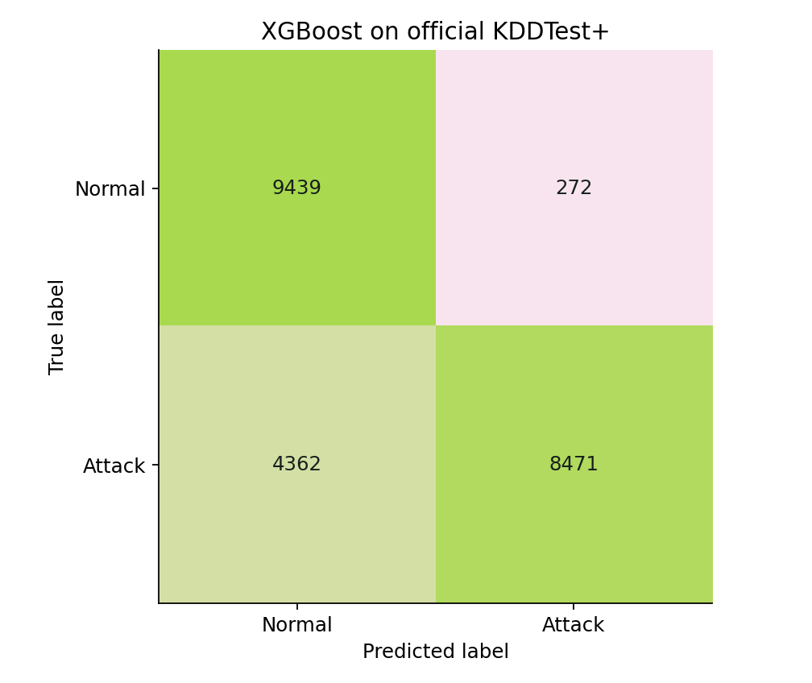

# Network intrusion detection with machine learning

A reproducible NSL-KDD benchmark and local CSV demo, developed from an Astana IT University team project. It connects cybersecurity with data preparation, feature engineering and model evaluation.

**Main finding:** the selected XGBoost model scores **0.9993 validation F1** on a random holdout from KDDTrain+, but **0.7852 F1 and 66.0% attack recall** on the separate official KDDTest+ file. The gap matters more than the near-perfect internal score.

[Evaluation details](docs/EVALUATION.md) · [Saved metrics](docs/results/metrics.json) · [Original team notebook](legacy/final_nslkdd.ipynb) · [Contributions](docs/CONTRIBUTIONS.md)

## What the project demonstrates

- A verified data download, a fixed split and a saved record of package versions.
- A feature-only schema: attack labels and the dataset difficulty field never enter the classifier.
- Two engineered traffic features, one-hot categorical encoding, numeric imputation and scaling fitted only on training data.
- Five classifiers plus a majority baseline, with model selection on a validation subset rather than on the official test.
- Attack recall, false positives, per-attack results and an audit of matching feature vectors across the official files.
- A local Streamlit demo and automated checks for leakage boundaries, unseen categories and malformed inputs.

## Reproduce the benchmark

Use Python 3.12 or newer. The published run used Python 3.14.6 on Linux and two CPU threads; a GPU is not required.

```bash
git clone https://github.com/Scirtor/nsl-kdd-intrusion-detection.git
cd nsl-kdd-intrusion-detection
python -m venv .venv
source .venv/bin/activate
python -m pip install -r requirements.txt
python -m nslkdd.data
python -m nslkdd.train --jobs 2
```

On Windows, activate `.venv\Scripts\activate` instead. `requirements-tested.txt` records the top-level dependency versions used for the published run; install that file when matching those versions is required.

The downloader fetches an immutable revision of a public mirror and checks SHA-256 hashes listed in `data-manifest.json`. Existing files are checked too. Dataset files and model binaries are excluded from Git.

Training writes the selected pipeline, metrics, split membership, predictions and figures to `runs/baseline/`. It refuses to overwrite an existing run. For another run, supply a new directory with `--output-dir runs/my-run`. The demo reads `runs/baseline/`.

## Results

Model choice uses a stratified 80/20 split of **125,973 KDDTrain+ records** with seed 42. Each candidate is fitted independently on the 100,778 fitting records; preprocessing is part of its pipeline.

| Candidate | Validation attack F1 | Validation attack recall |
| --- | ---: | ---: |
| Majority baseline | 0.0000 | 0.0000 |
| Logistic Regression | 0.9694 | 0.9628 |
| Random Forest | 0.9991 | 0.9987 |
| KNN | 0.9966 | 0.9961 |
| XGBoost | 0.9993 | 0.9993 |
| Linear SVM | 0.9703 | 0.9638 |

After selection, XGBoost is refitted on all KDDTrain+ records. No parameter or threshold is adjusted using KDDTest+.

| Official KDDTest+ metric | Value |
| --- | ---: |
| Records | 22,544 |
| Accuracy | 79.44% |
| Attack precision | 96.89% |
| Attack recall | 66.01% |
| Attack F1 | 0.7852 |
| ROC AUC | 0.9655 |
| False positive rate | 2.80% |





The audit found 664 test rows whose 41-feature vectors match a training-file vector. The official split is retained for the primary result. An additional evaluation excluding those matches gives **0.7760 F1**; both results are saved. See [the full evaluation](docs/EVALUATION.md) for interpretation and limitations.

## Try the local demo

After training the baseline:

```bash
streamlit run app.py --server.address 127.0.0.1
```

The demo starts with four sample connections and accepts CSV files with the 41 NSL-KDD feature columns. It validates inputs, predicts Normal or Attack and exports a result CSV. Labels or other extra columns are discarded. There is no model-upload feature or external inference API.

This is a classifier for precomputed benchmark features, not a live packet sniffer, SOC alerting service or deployable intrusion prevention system. Only load model files generated locally from trusted code; joblib files are Python serialisations.

## Checks

```bash
python -m pip install -r requirements-dev.txt
python -m pytest -q
python -m nslkdd.report
```

The last command regenerates figures from saved metrics without retraining. GitHub Actions runs the unit checks; full training is a separate local workflow.

## Project map

```text
nslkdd/             schema, verified downloads, features, training and reports
app.py              local CSV demonstration
tests/              pipeline and report checks
examples/           four feature-only NSL-KDD sample rows
docs/results/       published metrics, tables and figures
legacy/             original academic notebook with outputs removed
```

## Attribution

Original team, CS-2406, Astana IT University:

- **Nurzhan Bekmurat** — data pipeline, exploratory analysis, feature engineering and report sections 1–3.
- **Shavkat Khanezar** — model training and tuning, and the original Streamlit application.
- **Yernur Khuan** — literature review, report sections 4–5 and presentation slides.

This repository adds a documented reproduction and evaluation refactor. It preserves the team's authorship rather than presenting all original work as one person's contribution. See [contribution notes](docs/CONTRIBUTIONS.md).

Dataset: [ISCX NSL-KDD, University of New Brunswick](https://www.unb.ca/cic/datasets/nsl.html). Citation: M. Tavallaee, E. Bagheri, W. Lu and A. A. Ghorbani, “A Detailed Analysis of the KDD CUP 99 Data Set,” CISDA, 2009. The original distributor currently no longer hosts the files; this project uses the pinned [defcom17 mirror](https://github.com/defcom17/NSL_KDD). The example rows are from that dataset. Dataset citation and redistribution terms remain applicable.
